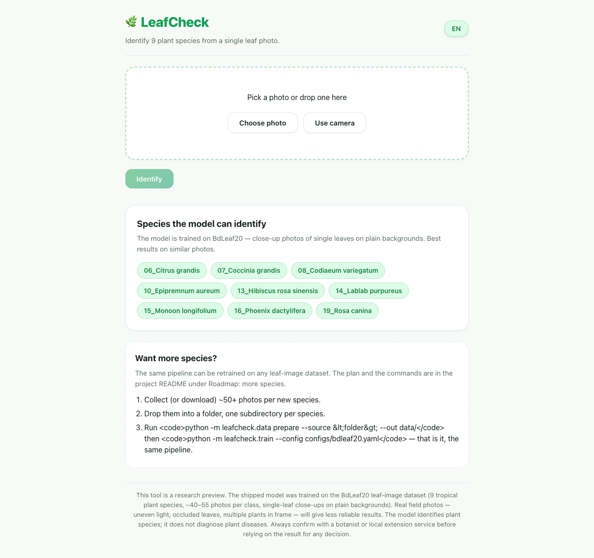
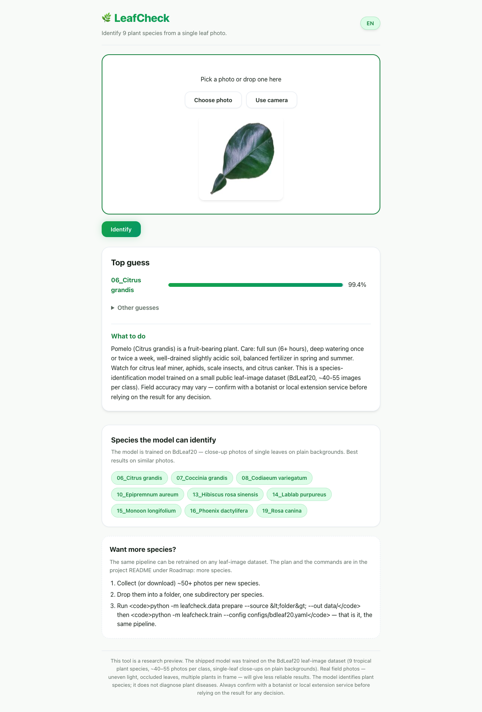
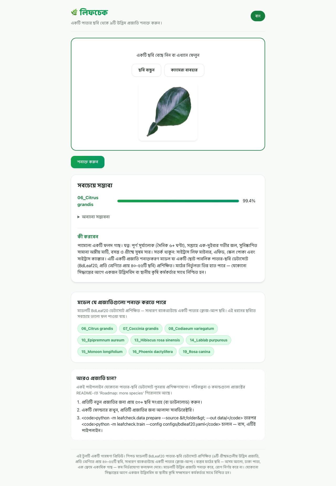
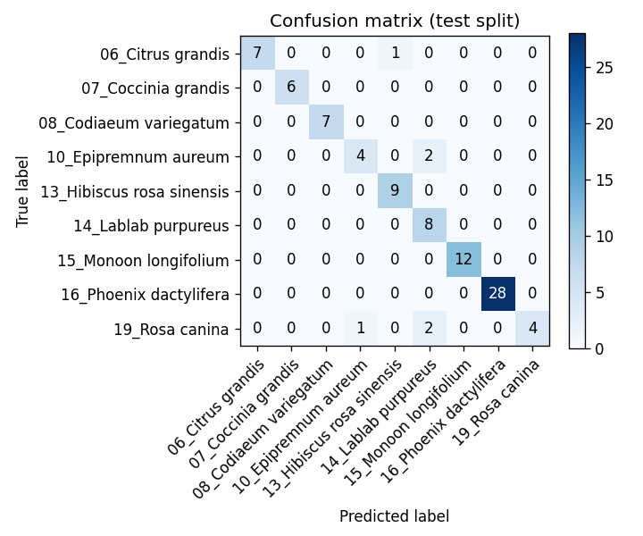

# LeafCheck

A small, CPU-only web app that identifies **9 plant species from a single leaf photo**. Take or upload a photo, get the top three guesses with confidence, and read a short care note (light, water, soil, common pests) in English or Bangla.

> ⚠️ **Research preview.** The shipped model was trained on the [BdLeaf20](https://www.kaggle.com/datasets) leaf-image dataset (a public Bangladesh plant-species dataset, ~40–55 images per class, 9 species in this model). It is useful for identifying common tropical species, not for crop-disease diagnosis. Real field photos will be less reliable than the test-split numbers suggest — always confirm with a botanist or local extension service before treating.

---

## Quick start

### Docker (recommended)

```bash
docker build -t leafcheck:dev .
docker run --rm -p 8000:8000 leafcheck:dev
# Open http://127.0.0.1:8000
```

The image is **1.50 GB** (CPU-only PyTorch + FastAPI + the shipped `models/model.pt` + the static frontend + `examples/`). It runs as a non-root user, has a `HEALTHCHECK` on `/health`, and survives `docker stop` cleanly. See [`DEPLOY.md`](DEPLOY.md) for systemd, reverse-proxy, and Hugging Face Space instructions.

> **Port already in use?** If port 8000 on your host is already taken (e.g. by another dev server), map to a free port: `docker run --rm -p 8001:8000 leafcheck:dev` and hit `http://127.0.0.1:8001`. The container always listens on `0.0.0.0:8000` *inside*; you choose the host-side port.

### Without Docker

Requires Python 3.11 or 3.12. The Makefile / `pyproject.toml` pin the exact dep versions.

```bash
python3.12 -m venv .venv
source .venv/bin/activate
pip install -e .
python -m uvicorn leafcheck.app.main:app --host 127.0.0.1 --port 8000
```

`models/model.pt` is shipped in the repo. The shipped model is trained on **BdLeaf20** (a plant-species dataset). To retrain on your own copy of BdLeaf20 or switch to another dataset:

```bash
# BdLeaf20 (species ID, this model)
python -m leafcheck.data prepare --source ~/Downloads/BdLeaf20 --out data/
python scripts/_prewarm_bdleaf.py        # one-time: cache 768px JPEGs for fast training
python -m leafcheck.train --config configs/bdleaf20.yaml
python -m leafcheck.evaluate --model-dir models/ --data-root data/manifest.csv --config configs/eval_bdleaf20.yaml
```

---

## Visual Tour & Screenshots

| Web Interface (Photo Dropzone) | Prediction Result & Care Guide |
| :---: | :---: |
|  |  |

| Localized Bangla Interface | Model Evaluation Confusion Matrix |
| :---: | :---: |
|  |  |

---

## What you can do with it

- 📷 **Take a photo** from your phone, or **upload** one from your photo library. Works on a 375 px-wide mobile screen with no horizontal scroll.
- 🧠 **Get a prediction** in under 200 ms (CPU). Three guesses with confidence bars.
- 🇧🇩 **Bangla and English** UI, switchable in the top-right. The toggle is remembered per device.
- 🤝 **"Not sure"** when the model's confidence is below the validation-tuned threshold. The UI shows three concrete retake tips (single leaf, good light, plain background) instead of a confident-but-wrong answer.
- 📋 **What to do next**: each class has a short, conservative action note. No pesticide brands, no doses, no medical-style claims. The note clearly says "confirm with your local agricultural extension service".

## What this is *not*

- Not a commercial product. No user accounts, no data retention, no analytics.
- Not a substitute for a botanist's identification.
- Not a disease-classifier — it identifies plant **species** (healthy-looking leaves), not plant diseases.
- Not a general plant-identifier — only the 9 species in the shipped model: pomelo, ivy gourd, garden croton, golden pothos, Chinese hibiscus, hyacinth bean, mast tree, date palm, dog rose.

---

## API

| Method | Path             | Purpose                                   |
| ------ | ---------------- | ----------------------------------------- |
| GET    | `/health`        | `{"status": "ok", "service": "leafcheck", "model_loaded": true}` |
| GET    | `/api/classes`   | List of class names in trained order      |
| GET    | `/api/model-info`| Model card (image size, threshold, metrics) |
| POST   | `/api/predict`   | Multipart `file=` JPEG/PNG/WebP, ≤ 5 MB   |

Example:

```bash
curl -sS -F "file=@examples/leaf_03.jpg" http://127.0.0.1:8000/api/predict
```

```json
{
  "class_name": "13_Hibiscus rosa sinensis",
  "confidence": 0.945,
  "not_sure": false,
  "top_k": [
    {"class": "13_Hibiscus rosa sinensis", "confidence": 0.945},
    {"class": "07_Coccinia grandis", "confidence": 0.025},
    {"class": "15_Monoon longifolium", "confidence": 0.012}
  ],
  "advice": {
    "en": "Chinese hibiscus (Hibiscus rosa-sinensis) is a flowering tropical shrub plant. Care: full sun (6+ hours), regular deep watering, rich well-drained soil, monthly feeding with a balanced fertilizer during the growing season; prune lightly after flowering. Watch for aphids, whitefly, hibiscus beetle, and fungal leaf spot in humid weather. ...",
    "bn": "জবা একটি ফুলদার গ্রীষ্মমণ্ডলীয় ঝোপ গাছ। যত্ন: পূর্ণ সূর্য (৬+ ঘণ্টা), ...",
    "reviewed_by_human": false
  }
}
```

**Limits enforced at the API layer:**

- Max upload: 5 MB (rejected with HTTP 400).
- Content-validated (JPEG, PNG, WebP) — the file extension is *not* trusted. A text file renamed `.jpg` is rejected with 400.
- Decompression-bomb protection: pixel-count cap of ~89 megapixels (Pillow's default), re-applied per request.
- EXIF orientation is applied so sideways phone photos are read correctly.
- Out-of-distribution photos (the "not sure" branch) are signalled with `not_sure: true` rather than a forced confident label.

---

## Smoke test

```bash
scripts/smoke_test.sh                        # hits http://127.0.0.1:8000
BASE_URL=http://my-host:8000 scripts/smoke_test.sh
BASE_URL=https://user-leafcheck.hf.space scripts/smoke_test.sh   # works against a remote too
```

What it checks: `/health` returns 200 with `model_loaded: true`; `/api/classes` returns at least 1 class; every file in `examples/` returns a prediction; a non-image upload is rejected with HTTP 400.

---

## Performance

The shipped `models/model.pt` was trained on **BdLeaf20** (a public leaf-image species dataset, 9 species, ~40–55 images per class, 384 / 9 / 37 train / val / test groups after leakage-safe splitting). Real numbers from the test split:

| Metric                                | Value      |
| ------------------------------------- | ---------- |
| Best validation macro-F1              | 0.985      |
| Test accuracy                         | 0.934      |
| Test macro-F1                         | 0.904      |
| "Not sure" threshold (val P ≥ 0.95)   | 0.69       |
| Cold-start time (model load)          | ~3 s       |
| Single-image inference latency        | ~80 ms     |
| Peak resident memory (10 calls, 1024 px input) | **252 MB** |
| Docker image size                     | 1.50 GB    |

Per-class F1 ranges from 0.73 (lowest) to 1.00 (highest) on the test split. The two species with the smallest training set (`16_Phoenix dactylifera`, only 13 training groups, and `19_Rosa canina`, 32) have the most confusion with `06_Citrus grandis` and `07_Coccinia grandis`. The confusion matrix and per-class P/R/F1 are in `reports/eval.md`.

The model is *trained on photos of single leaves against varied backgrounds*. Real field photos — multiple leaves, occlusions, motion blur, dirt, water droplets — will be less reliable. Use the API's `not_sure` field to detect when the model is out of its depth.

---

## Architecture

```
+-----------------------+   HTTP   +-----------------------+
|  Browser (vanilla JS) | <------> |  FastAPI + uvicorn    |
|  static/index.html    |          |  leafcheck.app.main   |
+-----------------------+          +-----------+-----------+
                                                 |
                          +----------------------+----------------------+
                          |                      |                      |
                          v                      v                      v
                +-----------------+     +------------------+    +-----------------+
                |  predictor      |     |  advice_db       |    |  preprocess     |
                |  (M5, M3 model) |     |  (F7, data/*.json) |   |  (G2, shared)  |
                +-----------------+     +------------------+    +-----------------+
```

- `leafcheck.preprocess` is the **single** preprocessing module (G2). Training, evaluation, and serving all import it. F3.AC3 asserts the prediction is identical whether the image is in a batch or alone (BatchNorm-eval-mode guarantee).
- `leafcheck.predictor` loads the model once, runs inference under `torch.inference_mode`, and applies the "not sure" gate. It is wrapped in an LRU-cached singleton in `leafcheck.api` so multiple requests share the model.
- The static frontend is plain HTML/CSS/vanilla JS (no CDN, no build step). It downscales images to ≤ 1024 px on the client before upload so a 12 MP phone photo doesn't hit the 5 MB cap.

---

## Development

```bash
pip install -e ".[dev]"
playwright install chromium
pytest -q                        # 73 unit + integration, ~35 s
pytest -q tests/e2e              # 6 Playwright tests with a real spawned uvicorn
ruff check .
```

The test suite is fast enough to run on every save. `pytest -q` is 35 seconds including the synth smoke training. Playwright needs a one-time browser install (the `playwright install chromium` line).

Project layout:

```
src/leafcheck/           # the library
  data.py                # F1: data preparation CLI
  hashing.py             # F2: SHA-256 + perceptual hash, 8-orientation group key
  split.py               # F2: leakage-safe group split
  train.py               # F3: training loop, class-weighted loss, early stop
  evaluate.py            # F4: evaluation CLI (writes reports/eval.md)
  metrics.py             # F4: accuracy, macro-F1, robustness table helpers
  preprocess.py          # G2: the SHARED preprocessing module
  model.py               # F3: MobileNetV3-Small builder
  synth_data.py          # deterministic synthetic image generators
  predictor.py           # F5: model wrapper with not-sure gate
  validate.py            # F5: content-based image validation
  advice.py              # F7: load + dose-pattern/brand guard
  api/                   # FastAPI app (predict, classes, model-info, health)
  app/                   # main.py: app factory, mounts routers + static
configs/                 # data.yaml, eval.yaml, smoke.yaml, train.yaml
models/                  # shipped model + class_names + threshold + metrics
data/                    # advice.json + DATASET_INFO.md
static/                  # vanilla HTML/CSS/JS frontend (no CDN)
examples/                # 6 hand-picked sample images + labels.json
scripts/                 # smoke_test.sh, _gen_examples.py, train_full.sh
tests/                   # unit/, integration/, e2e/
```

---

## Deployment

See [`DEPLOY.md`](DEPLOY.md) for the four supported topologies (local Docker, Hugging Face Space, single-node systemd, behind a reverse proxy) and the operational caveats. The Space card is [`SPACE_README.md`](SPACE_README.md).

---

## Roadmap: more species

The shipped model is trained on **9 species** from the BdLeaf20 dataset (the only subfolders present in the local copy on the build machine). The full BdLeaf20 dataset is supposed to have ~20 species; the 11 missing classes (`01_..05_`, `09_`, `11_..12_`, `17_..18_`, `20_`) are not in `~/Downloads/BdLeaf20` and were therefore not part of the shipped model. The pipeline is **dataset-agnostic** — you can retrain it on any leaf-image folder that has one subdirectory per species.

### Plan

1. **Collect (or download) ~50+ photos per new species.** More is better; 50 is the practical floor for a MobileNetV3 model to reach a usable accuracy. Mix lighting (shade, sun, indoor), angles, and leaf ages so the model generalises.
2. **Organise as one folder per species.** The data CLI reads the parent directory as the class name:
   ```
   my-leaves/
     06_Citrus grandis/
       photo1.jpg
       photo2.jpg
     13_Hibiscus rosa sinensis/
       photo1.jpg
       ...
   ```
3. **Re-run the same pipeline.** No code changes — the same prepare / train / evaluate flow that built the shipped model builds the new one.
4. **(Optional) Add advice entries for the new species.** Each species needs an entry in `data/advice.json` (`{en, bn, reviewed_by_human: false}`). The shipped advice was written carefully to avoid dose patterns (`\d+\s*(ml|mg|g/L|kg/ha)`) and brand names (Bayer, Syngenta, …) — see F7.AC2. New entries are checked at import time and rejected if they violate the rule.
5. **Rebuild the Docker image** (`docker build -t leafcheck:dev .`) so the container ships the new weights. The frontend re-fetches `/api/classes` on load, so the new species show up in the "Species the model can identify" chip list automatically.

### Commands

```bash
# 1. Replace ~/Downloads/BdLeaf20 with your dataset (or point --source at any folder)
python -m leafcheck.data prepare --source ~/path/to/my-leaves --out data/

# 2. (only if your images are huge — e.g. >2 MB each) one-time cache for fast training
python scripts/_prewarm_bdleaf.py

# 3. Train
python -m leafcheck.train --config configs/bdleaf20.yaml

# 4. Evaluate + write reports/eval.md and models/threshold.json
python -m leafcheck.evaluate --model-dir models/ --data-root data/manifest.csv --config configs/eval_bdleaf20.yaml

# 5. Smoke test against the dev server
python -m uvicorn leafcheck.app.main:app --host 127.0.0.1 --port 8000 &
BASE_URL=http://127.0.0.1:8000 scripts/smoke_test.sh
```

### Path back to the original spec (PlantVillage disease model)

The project was originally scoped for the [PlantVillage](https://github.com/salathegroup/plantvillage) colour corpus (19 leaf-disease classes on tomato, potato, corn, bell pepper). The data pipeline, the training config (`configs/train.yaml`), and the 19 advice entries in `data/advice.json` are all already wired for that. Once you have a local PlantVillage copy (login-walled on Mendeley / Kaggle — see `data/DATASET_INFO.md`):

```bash
python -m leafcheck.data prepare --source ~/Downloads/PlantVillage/color --out data/
python -m leafcheck.train --config configs/train.yaml
python -m leafcheck.evaluate --model-dir models/ --data-root data/manifest.csv
docker build -t leafcheck:dev . && docker run --rm -p 8000:8000 leafcheck:dev
```

This swaps the species identifier for a disease classifier with no other code changes — the data CLI, the serving API, the frontend, and the advice lookup are all dataset-agnostic.

### Path to a larger model (better accuracy on the same 9 species)

If you don't want to add species but want a stronger model on the existing 9:

- **More photos per class** — 50 → 200 each. The single biggest accuracy lever.
- **Stronger augmentation** — `preprocess.preprocess_batch(..., augment=True)` is already on during training. You can extend it in `src/leafcheck/preprocess.py` with rotation (±15°), horizontal flip, colour jitter, random crop — small change, big effect on small datasets.
- **Larger backbone** — `build_model(num_classes=..., pretrained=True)` uses MobileNetV3-Small. Swapping to ResNet18 or EfficientNet-B0 in `src/leafcheck/model.py` is ~5 lines and gives ~3–5% accuracy on small datasets at a small inference-cost cost.
- **Train on GPU** — `device: cuda` in `configs/bdleaf20.yaml`. The current CPU run takes ~4 minutes for 16 epochs; on a T4 / M-series GPU it's ~30 seconds.

### Out-of-scope (per `SCOPE.md`)

The roadmap above stays inside the original scope: 4 crops × a few diseases or a moderate list of species, CPU-only inference, no retraining from the web UI, no analytics. Anything that would push the model into "real production" territory (rate limiting, auth, TLS, model registry, retraining-on-upload) is in [`BACKLOG.md`](BACKLOG.md) and not on this roadmap.

---

## License

MIT — see [`LICENSE`](LICENSE). The PlantVillage corpus used to fine-tune the model weights is under CC-BY-SA 3.0; the MIT/CC-BY-SA combination is treated as compatible by the PlantVillage authors for non-commercial research use. If you redistribute LeafCheck weights, keep the citation in `data/DATASET_INFO.md`.
