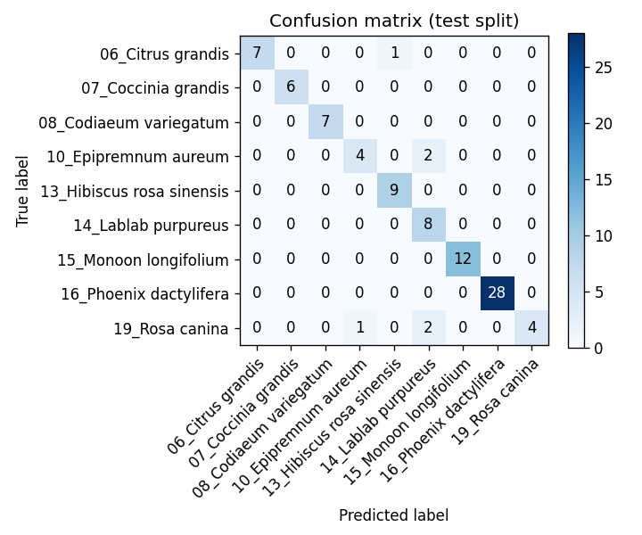

# LeafCheck — evaluation report

> Auto-generated by `python -m leafcheck.evaluate`. Do not edit by hand.

## Headline

- Test accuracy: **0.9341**
- Test macro-F1: **0.9039**
- "Not sure" threshold: **0.69** (validation precision at threshold: 0.9608, target: 0.95)
- Test coverage at threshold: **0.8791**
- Validation coverage at threshold: **0.8361**

## Per-class metrics

| class | precision | recall | f1 | support |
|---|---|---|---|---|
| 06_Citrus grandis | 1.0000 | 0.8750 | 0.9333 | 8 |
| 07_Coccinia grandis | 1.0000 | 1.0000 | 1.0000 | 6 |
| 08_Codiaeum variegatum | 1.0000 | 1.0000 | 1.0000 | 7 |
| 10_Epipremnum aureum | 0.8000 | 0.6667 | 0.7273 | 6 |
| 13_Hibiscus rosa sinensis | 0.9000 | 1.0000 | 0.9474 | 9 |
| 14_Lablab purpureus | 0.6667 | 1.0000 | 0.8000 | 8 |
| 15_Monoon longifolium | 1.0000 | 1.0000 | 1.0000 | 12 |
| 16_Phoenix dactylifera | 1.0000 | 1.0000 | 1.0000 | 28 |
| 19_Rosa canina | 1.0000 | 0.5714 | 0.7273 | 7 |

## Confidence-bucket accuracy (test split)

| bucket | n | accuracy |
|---|---|---|
| [0.00, 0.50) | 5 | 0.6000 |
| [0.50, 0.80) | 10 | 0.7000 |
| [0.80, 0.95) | 17 | 1.0000 |
| [0.95, 1.00) | 59 | 0.9831 |

## Robustness (test split)

| perturbation | accuracy | n |
|---|---|---|
| baseline | 0.9062 | 32 |
| blur_r2 | 0.8750 | 32 |
| blur_r4 | 0.8750 | 32 |
| bright_1.2 | 0.9375 | 32 |
| bright_0.8 | 0.9375 | 32 |
| contrast_1.2 | 0.9375 | 32 |
| contrast_0.8 | 0.9062 | 32 |
| jpeg_50 | 0.9062 | 32 |
| jpeg_20 | 0.9062 | 32 |
| rot_5 | 0.9375 | 32 |
| rot_neg_5 | 0.9062 | 32 |
| center_crop_0.8 | 0.9375 | 32 |

## Confusion matrix

## Limitations (plain language)

These numbers are reported on the **test split** of the BdLeaf20 leaf-image dataset (a small public plant-species identification dataset, ~40-55 images per class, 9 species in this model). The photos are close-up top-down shots of single leaves against varied backgrounds. Real field photos — uneven lighting, occluded leaves, multiple diseases or plant parts in one shot, dirt, water droplets, motion blur — will look very different and the model's accuracy will be lower. The confidence-bucket table and the robustness table are honest attempts to show how brittle the model is, not just how good it is on the test set.
